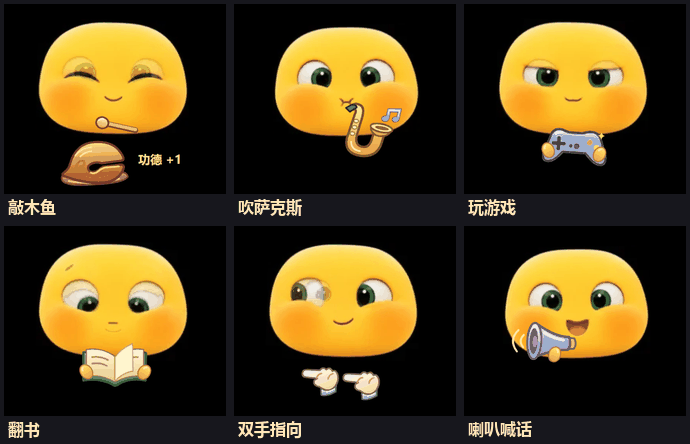
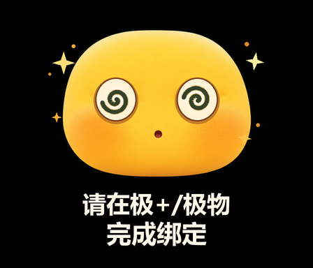

# 奶龙上屏 · EVA 圆角方屏表情全集

[在线浏览 116 项表情](https://498600589-byte.github.io/Zeekr-EVA-remix/library.html#library) · [四款精选 GIF](media/nailoong-four.gif) · [静态对照图](media/preview.png) · [首批关键帧](media/keyframes.png) · [扩展关键帧](media/extended-keyframes.png)

## v2.4.2 奶龙的动作道具

木鱼有开口和软垫，敲击时木槌回弹；奶龙拿起萨克斯时吹嘴贴到嘴边，捧书时书页会翻动。左、右喊话分别把喇叭朝向对应一侧。网页的 101 个带符号场景共用 59 种画法，设备包有 60 项资源更新。

[下载 v2.4.2 设备包](https://github.com/498600589-byte/Zeekr-EVA-remix/releases/download/v2.4.2/eva-nailoong-v2.4.2.zip) · [播放敲木鱼](https://498600589-byte.github.io/Zeekr-EVA-remix/library.html?expression=76#library)

## v2.4.1 提示符号校正

按 EVA 原动作的含义重绘了连接转圈、送风扇叶、木鱼和「功德 +1」、白手套、双手指向、旋转星环、搜索放大镜、蓝色双目镜和分左右方向的紫色喇叭。网页的连接场景使用新图案。实机包包含 75 项表情、开机动画和待绑定画面。

[下载奶龙 v2.4.1](https://github.com/498600589-byte/Zeekr-EVA-remix/releases/tag/v2.4.1) · [播放敲木鱼](https://498600589-byte.github.io/Zeekr-EVA-remix/library.html?expression=76#library) · [播放双目镜](https://498600589-byte.github.io/Zeekr-EVA-remix/library.html?expression=110#library)

## 大符号实机包

爱心、问号和搜索提示都放大了。下载包内含 75 个表情、开机动画和待绑定画面，已在资源盘副本验证安装与恢复。[下载奶龙 ZIP](https://github.com/498600589-byte/Zeekr-EVA-remix/releases/download/v2.4.2/eva-nailoong-v2.4.2.zip)

## 奶龙开机与待绑定

机甲和奶龙是给车里亲子时光准备的。等人、休息时，爸妈可以和孩子一起学 EVA 做表情，猜它接下来会偷瞄、憋笑，还是被自己转晕。

上电时，奶龙的螺旋眼慢慢转动。等待绑定时，画面停在同一张眩晕脸。下方全程显示「请在极+/极物完成绑定」。

 

开机和待绑定两张画面已适配并写入一台资源版本为 `0.0.14` 的 EVA。另有 75 项奶龙表情已转换并通过该设备的写入回读校验，涵盖四款精选、眨眼、打哈欠等。下方的 116 项是完整网页预览目录。

## 奶龙全集更新

四款精选更新为 30 帧/秒 MP4，GitHub 首页的奶龙对比动图更新为 25 帧/秒。全集给表情关键姿势加了过渡帧，切换编号时衔接上一画面。横向对比会等新动图解码后再换画面。

新增 116 个 EVA 编号的在线目录与逐项播放器。目录可按日常表情、眼神与手势、迎宾与对话、音乐与玩乐、车内与充电、驾驶提示、节日与问候、创意特效和创意补位筛选，也可按中文名、资源名或编号搜索。

新增睡觉、打哈欠、俏皮单眼眨、害羞、撅嘴、抬眼、低头和说话等关键姿势，配合各场景的表情节奏和提示图案。聆听、音乐、跳舞等连续动作在网页上保留入场、持续、退场的区别。原来缺少可确认素材的八个编号提供原创补位。

## 四款搞笑精选

这次更新把奶龙的头部稍微压宽，保留圆眼、鼓脸颊和柔和的明暗，在模拟的 EVA 圆角方屏四周留出安全区。四款动效可以单独播放、暂停或一起看。

| 表情 | 动作节奏 | 文件 |
| --- | --- | --- |
| 憋笑失败 | 鼓脸憋住，嘴角慢慢绷不住，突然笑开 | [MP4](media/laugh.mp4) · [PNG](media/laugh.png) |
| 装乖偷瞄 | 先正眼微笑，再把瞳孔往一边移，最后收回 | [MP4](media/side-eye.mp4) · [PNG](media/side-eye.png) |
| 秒变委屈 | 笑脸收下去，瘪嘴冒泪，最后留下一个小撇嘴 | [MP4](media/pout.mp4) · [PNG](media/pout.png) |
| 震惊呆住 | 眼睛和嘴同时睁圆，停一拍再眨眼恢复 | [MP4](media/surprise.mp4) · [PNG](media/surprise.png) |

116 项对应网页上的演示。表情方案按场景复用关键姿势，页面含四款独立 MP4、对应静态图及两张关键帧图。[已有可部署角色与 JOJO 资源](https://github.com/498600589-byte/Zeekr-EVA-remix#choose-an-expression-style)

## English

The mecha and Nailoong styles give parents and kids a few more ways to play with EVA while waiting or taking a break in the car. Try copying its faces or guessing which expression comes next.

The full gallery covers all 116 entries in the EVA expression map. Use the category filter or search by name or ID. Each entry plays on the rounded-rectangle screen with scene-specific timing and cues. Eight mapped entries with unconfirmed original visuals have original preview treatments.

The four original clips are **Holding Back a Laugh**, **Innocent Side-Eye**, **Sudden Pout**, and **Awkward Surprise**. They keep their individual MP4 loops and stills. The larger browser gallery reuses the key poses across appropriate scenarios. The dizzy-eyed startup and pairing screens were installed on an EVA running resource version 0.0.14. Seventy-five other Nailoong expressions were converted and checked after writing to that device.

The fan-made preview uses the official character design as a visual reference. [Nailoong official site](https://www.nailoong.com/)
