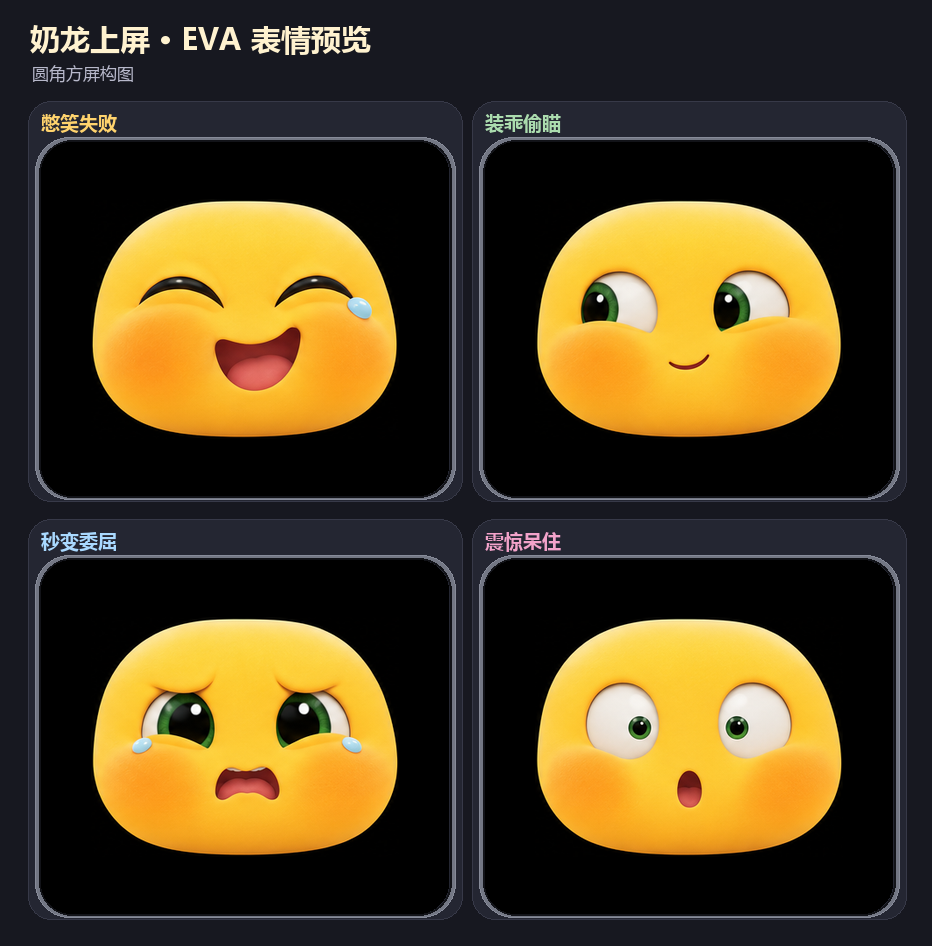
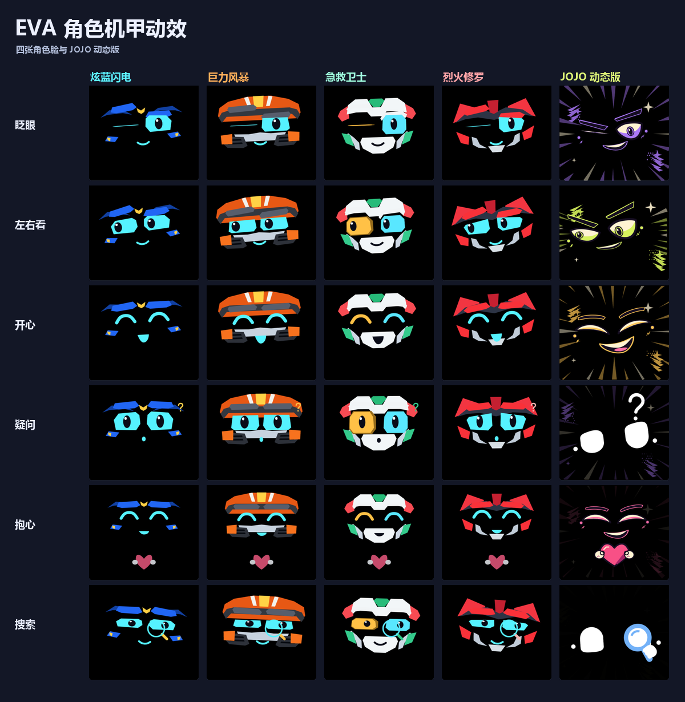
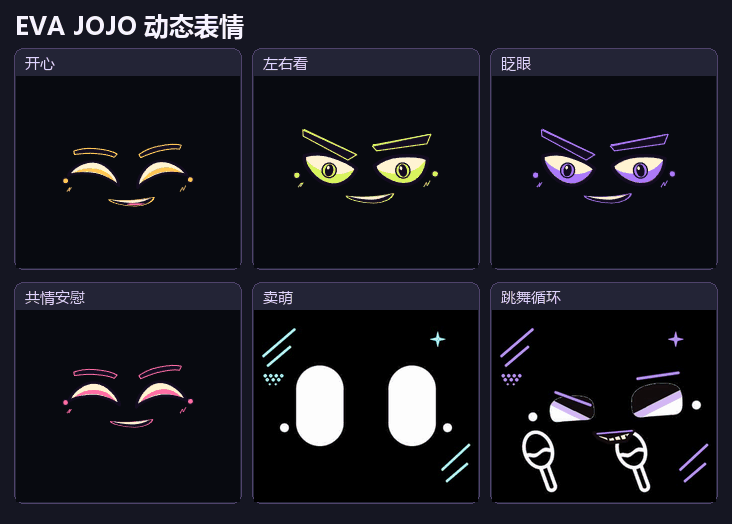

# Zeekr EVA Remix

## Nailoong on EVA

The live Nailoong gallery covers all 116 entries in the EVA expression map. Search by expression name or ID, filter by category, and play the selected motion on a rounded screen. The four original comedy loops remain together at the top.

[Open the full gallery](https://498600589-byte.github.io/Zeekr-EVA-remix/#library) · [奶龙更新说明与素材](docs/nailoong/README.md) · [Download the four-clip GIF](docs/nailoong/media/nailoong-four.gif)



## Choose an expression style

The four **EVA Character Mecha** packs feature distinct faces and animations for Blue Cop, Mega Trucker, Mega Ambler, and Phoenix Fire. Each package covers the EVA's 116 mapped expressions plus the supplementary resources. The offline comparison features six clips, including Blink, Look, and Comfort.

[Character packs](https://github.com/498600589-byte/Zeekr-EVA-remix/releases/tag/v2.2.0) · [Download the animation comparison](https://github.com/498600589-byte/Zeekr-EVA-remix/releases/download/v2.2.0/EVA_Cardbot_Comparison.html) · [中文角色与安装指南](styles/cardbot/README.zh-CN.md) · [English character guide](styles/cardbot/README.md)



## Six-expression colorway kit

The style kit offers five mecha colorways and JoJo Motion v2 for the same six animated expressions. Watch the side-by-side player in the ZIP, then select a style with the Windows installer. The installer backs up the six expressions on your EVA so you can switch styles or restore what you started with.

[Download the Style Kit](https://github.com/498600589-byte/Zeekr-EVA-remix/releases/download/v2.1.0/EVA_Style_Kit_v2.1.0.zip) · [Style guide](styles/README.md) · [中文风格与安装指南](styles/README.zh-CN.md)

## JoJo Motion v2 full pack

JoJo Motion v2 upgrades the screen expressions for the Zeekr EVA ICR10Z1A with resource version `0.0.14`. The new animations use anticipation, punch-in poses, sweeping speed lines, and expressive changes in timing. The pack updates 128 animations across 57 Lottie and 71 packed JPEG assets.

[Download JoJo Motion v2](https://github.com/498600589-byte/Zeekr-EVA-remix/releases/download/v2.0.0/EVA_JOJO_Motion_v2.0.0.zip) · [Release notes](https://github.com/498600589-byte/Zeekr-EVA-remix/releases/tag/v2.0.0) · [中文安装说明](docs/jojo-motion-v2.zh-CN.md)



The release ZIP includes the complete pack, an offline side-by-side player, and a Windows installer for the stock resources or the verified previous JoJo pack. The installer backs up the current assets before writing and can restore them later. V2 passed file and frame checks and install/restore tests on copies of both supported resource sets. V2 playback on the EVA screen is still unverified.

You can also try a single v2 Lottie sample using the guide below. Each sample is self-contained and matches the timing and canvas of its mapped expression.

| ID | Expression | Sample |
| --- | --- | --- |
| 4 | Blink | [Blink.json](examples/jojo-v2/Blink.json) |
| 22 | Look left and right | [Look.json](examples/jojo-v2/Look.json) |
| 50 | Happy | [Happy.json](examples/jojo-v2/Happy.json) |
| 104 | Comfort | [L00000104.json](examples/jojo-v2/L00000104.json) |

## Find AGao on the Road

Search for **阿糕在路上** on **Douyin**, **Xiaohongshu (REDnote)**, or **WeChat Channels**. The original sample expressions in this repository are free to download.

## 1. Connect EVA to Windows

Connect EVA directly to your Windows PC with a USB-C data cable. Open **Device Manager → Ports (COM & LPT)** and look for the two serial ports that appear when EVA is connected. One carries logs. The other accepts commands and answers `GET` with a memory report.

To inspect the ports from PowerShell, run:

```powershell
[System.IO.Ports.SerialPort]::GetPortNames()
```

## 2. Open the EVA resource drive

Set `$evaPort` to EVA's command port. `COM4` is the port we used. The script checks for `total ram` in the `GET` response before sending `OPEN`. Windows then switches EVA from two serial ports to a removable **TinyUSB Flash Storage** drive. Ours mounted as `H:`.

```powershell
$evaPort = 'COM4'
$port = [System.IO.Ports.SerialPort]::new($evaPort, 115200)
$port.DtrEnable = $true
$port.WriteTimeout = 1000
try {
    $port.Open()
    $port.DiscardInBuffer()
    $port.Write("GET" + [char]10)
    Start-Sleep -Milliseconds 700
    if ($port.ReadExisting() -notmatch 'total ram') {
        throw 'No EVA memory response. Check which ports belong to EVA and try its other port.'
    }
    $port.Write("OPEN" + [char]10)
} finally {
    $port.Dispose()
}
```

Wait a few seconds, then open the new drive in File Explorer. Check for both files below before backing up or writing anything. You can open the resource drive from the command port while EVA is in its normal mode.

```text
local/EmojiMapList.json
local/emoji/EmojiList.json
```

## 3. Back up the drive

Replace `H:\` with the drive letter assigned to EVA. Copy the drive to a new local folder so you can restore the original artwork and its file manifest later.

```powershell
robocopy 'H:\' '.\eva-backup' /E /COPY:DAT /R:1 /W:1 /XD 'System Volume Information' 'SYSTEM~1'
```

Check that the backup contains `version.txt` and both JSON files listed above. The replacement tool checks the original expression byte for byte and verifies its CRC against the backup before it writes.

## 4. Swap a Lottie expression

The mapping in `EmojiMapList.json` connects expression IDs to filenames. Keep the existing ID and format to preserve the event that selects the expression. The original coordinates in our samples are already oriented for the EVA screen.

| Resource type | What to preserve |
| --- | --- |
| Lottie JSON (`type 0`) | The target's canvas size, frame rate, timing, and matched filename. |
| Packed JPEG frames (`type 1`) | The `.dat` container, frame dimensions, and playback sequence. Its little-endian header is described in the [DAT format notes](docs/dat-format.md). |
| Static JPG | The filename, dimensions, and visible information in the original image. |

The command below uses Python 3.10 or later and swaps **Happy (ID 50)** for the [v2 animation](examples/jojo-v2/Happy.json). It updates the matching CRC16 entry in `EmojiList.json` automatically. For the first JoJo sample, use `examples\jojo\Happy.json` as the input.

```powershell
python tools/replace_lottie.py apply --drive 'H:\' --backup '.\eva-backup' --id 50 --input '.\examples\jojo-v2\Happy.json'
```

Safely eject the drive, then disconnect and reconnect EVA to reload its resources. For playback, trigger the matching event through the car. Keep navigation, charging, seat belt, and warning icons legible when designing your own expressions.

To undo the example, open the resource drive again and restore the same ID from your backup:

```powershell
python tools/replace_lottie.py restore --drive 'H:\' --backup '.\eva-backup' --id 50
```

The tool restores the selected asset and its CRC entry. Keep a fresh full backup if you are working on several versions of the pack.

## Troubleshooting

| What you see | What to check |
| --- | --- |
| `GET` returns no memory report. | Confirm which two ports appeared when EVA was connected. Try the other EVA port and keep the newline in the command. |
| The ports disappear after `OPEN`. | Give Windows a few seconds to mount the resource drive. Check **This PC** for a new removable drive containing `local/EmojiMapList.json`. |
| The swap tool reports a CRC or backup mismatch. | Check that the backup came from the same EVA and compare its resource version. If the expression was already customized, restore its saved original before trying another swap. |
| EVA still displays the same expression. | Reconnect after safely ejecting the drive, then trigger the selected expression through the paired car. The USB resource view is for accessing files. |

## Case study · The first JoJo pack


We exaggerated the eye angles, added crooked smiles, and used ink slashes and halftone dots around the face. Three [first-release Lottie samples](examples/jojo/) remain available.

On one EVA unit, the first pack wrote and read back **131 assets** covering **116 mapped IDs** and 15 supplementary assets. Every changed asset passed SHA-256 and CRC readback checks. Playback for the car-triggered events was still pending.
