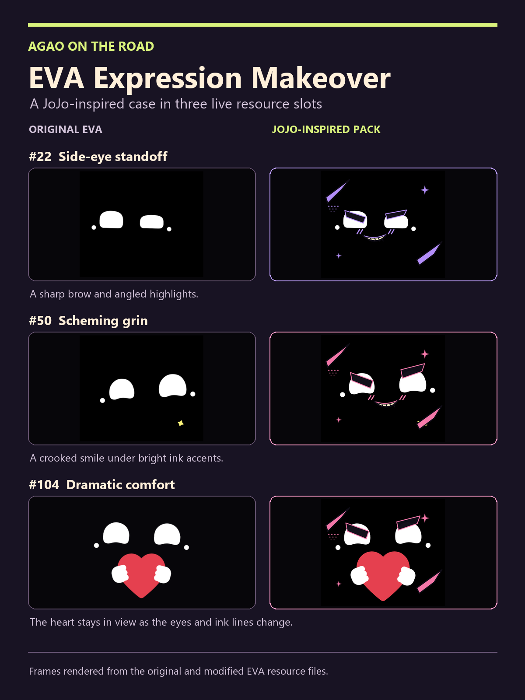

# Customize the Zeekr EVA Robot’s Expressions

Connect an EVA robot to Windows, open its USB resource drive, and try a JoJo-inspired expression. The walkthrough and case below use an EVA ICR10Z1A with resource version `0.0.14`.



## Follow AGao on the Road

Search for **阿糕在路上** on **Douyin**, **Xiaohongshu (REDnote)**, or **WeChat Channels**. The original sample expressions in this repository are free to download.

## 1. Connect EVA to Windows

Use a USB-C cable that supports data, connect EVA directly to the computer, and open **Device Manager → Ports (COM & LPT)**. EVA appeared as two USB serial ports on our machine. One carries logs. The other answers service commands such as `GET` and `OPEN`. Use the port numbers shown on your machine.

To inspect the ports from PowerShell, run:

```powershell
[System.IO.Ports.SerialPort]::GetPortNames()
```

## 2. Open the EVA resource drive

Set `$evaPort` to the EVA command port. The script checks for an EVA memory response before sending `OPEN`. On our unit, the serial ports disappeared and Windows mounted a removable drive named **TinyUSB Flash Storage**. The drive letter was `H:`.

```powershell
$evaPort = 'COM4'
$port = [System.IO.Ports.SerialPort]::new($evaPort, 115200)
$port.DtrEnable = $true
$port.WriteTimeout = 1000
try {
    $port.Open()
    $port.DiscardInBuffer()
    $port.Write("GET" + [char]10)
    Start-Sleep -Milliseconds 700
    if ($port.ReadExisting() -notmatch 'total ram') {
        throw 'No EVA memory response. Check which ports belong to EVA and try its other port.'
    }
    $port.Write("OPEN" + [char]10)
} finally {
    $port.Dispose()
}
```

Wait a few seconds, then confirm that the drive contains both files below. `OPEN` is the resource-drive command. The touchscreen factory test menu is optional.

```text
local/EmojiMapList.json
local/emoji/EmojiList.json
```

## 3. Back up the drive

Replace `H:\` with the EVA drive letter and copy the drive to a new local folder. Keep this copy for restoring the original artwork and file manifest.

```powershell
robocopy 'H:\' '.\eva-backup' /E /COPY:DAT /R:1 /W:1 /XD 'System Volume Information' 'SYSTEM~1'
```

Check that the backup contains `version.txt` and both JSON files listed above. The replacement tool checks the original expression byte for byte and verifies its CRC against the backup before it writes.

## 4. Try a different expression style

The mapping in `EmojiMapList.json` connects expression IDs to filenames. Keep the existing ID and format to preserve the event that selects the expression. The original coordinates in our samples are already oriented for the EVA screen.

| Resource type | What to preserve |
| --- | --- |
| Lottie JSON (`type 0`) | The target's canvas size, frame rate, timing, and matched filename. |
| Packed JPEG frames (`type 1`) | The `.dat` container, frame dimensions, and playback sequence. Its little-endian header is described in the [DAT format notes](docs/dat-format.md). |
| Static JPG | The filename, dimensions, and visible information in the original image. |

Start with a single Lottie expression. The command below uses Python 3.10 or later and swaps **Happy (ID 50)** for the included [JoJo-inspired portrait](examples/jojo/Happy.json). It updates the matching CRC16 entry in `EmojiList.json` automatically.

```powershell
python tools/replace_lottie.py apply --drive 'H:\' --backup '.\eva-backup' --id 50 --input '.\examples\jojo\Happy.json'
```

Safely eject the removable drive, then disconnect and reconnect EVA so it reloads its resources. Trigger the corresponding expression through the car to check how it looks on screen. When trying other designs, keep navigation, charge, seat belt, and warning icons legible.

To undo the example, open the resource drive again and restore the same ID from your backup:

```powershell
python tools/replace_lottie.py restore --drive 'H:\' --backup '.\eva-backup' --id 50
```

The tool restores the selected asset and its CRC entry. Keep a fresh full backup if you are working on several versions of the pack.

## Case study · The JoJo-inspired smirk pack

We exaggerated the eye angles, added crooked smiles, and used ink slashes and halftone dots around the face. The case image shows actual frames from the original EVA assets and our finished pack. The included [Lottie samples](examples/jojo/) are standalone illustrations you can try one at a time.

We wrote and read back **131 assets** on one EVA unit. The set covers **116 mapped IDs**, including nine previously missing files, plus 15 supplementary assets. Every changed asset passed the SHA-256 and CRC readback checks. Physical playback under each car-triggered event has yet to be verified.
